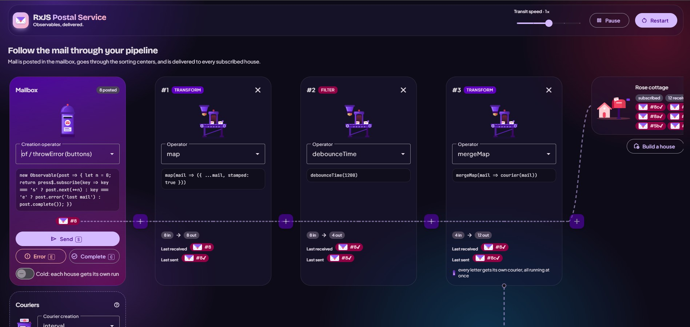

# RxJS Postal Service

An interactive playground for learning RxJS. You build an observable pipeline as a postal network, then watch every letter travel from the mailbox, through the sorting centers, to the houses that subscribe to it.



## The metaphor

| Postal network       | RxJS                                                         |
| -------------------- | ------------------------------------------------------------ |
| Mailbox              | Source observable (`interval`, `timer`, `from`, `range`, …)  |
| Letter               | Emitted value (`next`)                                       |
| Sorting center       | Pipeable operator (`map`, `filter`, `take`, …)               |
| Courier dispatch     | Inner observable of a flattening operator (`mergeMap`, …)    |
| House                | Subscriber                                                   |
| Lost mail / closed   | `error` / `complete`                                         |

## Features

- **Sources:** `interval`, `timer`, `from`, `range` and `defer`, plus a manual mailbox where you send, fail or close the stream yourself.
- **40+ operators** across transform, filter, utility, combination and multicasting. You can open and close sorting centers anywhere in the pipeline.
- **Flattening operators made visible:** `mergeMap`, `switchMap`, `concatMap` and `exhaustMap` send couriers, so you can see inner subscriptions run in parallel, get cancelled, queue up or get ignored.
- **Hot vs cold:** a shared mailbox, where late subscribers miss past mail, or one run per house.
- **Multicasting:** `share` and `shareReplay` merge every house's lane into one shared stream.
- **Subscribers:** add houses, remove them, or toggle each one between subscribed and unsubscribed.
- **Time control:** pause, resume, restart, and speed from 0.25× to 4×. Every timed operator runs on a custom scheduler, so all of them follow these controls.
- **Equivalent code:** a live code panel shows the RxJS code for the pipeline you've built.

### Keyboard shortcuts (manual mailbox)

| Key | Action                         |
| --- | ------------------------------ |
| `s` | Send a letter (`next`)         |
| `e` | Lose the mail (`error`)        |
| `c` | Close the mailbox (`complete`) |

## Getting started

Requires Node.js 22.22+ or 24.15+.

```bash
npm install
npm start
```

Then open http://localhost:4200.

### Other scripts

```bash
npm test        # unit tests (Vitest)
npm run build   # production build (with SSR) in dist/
npm run serve:ssr:rxjs-postal-service   # serve the production build
```

## Tech stack

Angular 22 (signals, zoneless, SSR) · RxJS 7 · Angular Material · Tailwind CSS 4 · Vitest

## Project structure

```
src/app/postal-service/
├── postal-service.*   # main component: pipeline builder, journey view, code panel
├── mail-catalog.ts    # sources, operators and couriers on offer
├── mail-clock.ts      # pausable, speed-adjustable scheduler
├── mail-transit.ts    # timing of letters travelling along the roads
└── mail-depot.ts      # courier tracking for flattening operators
public/mailman/        # SVG illustrations
```

## License

[MIT](LICENSE)
